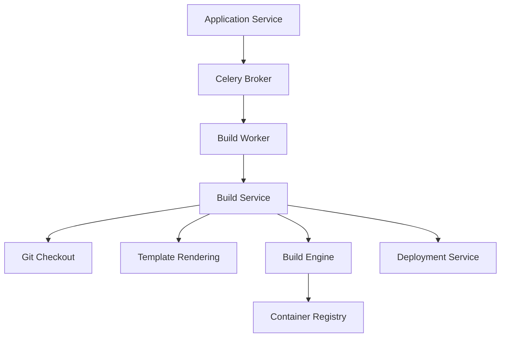
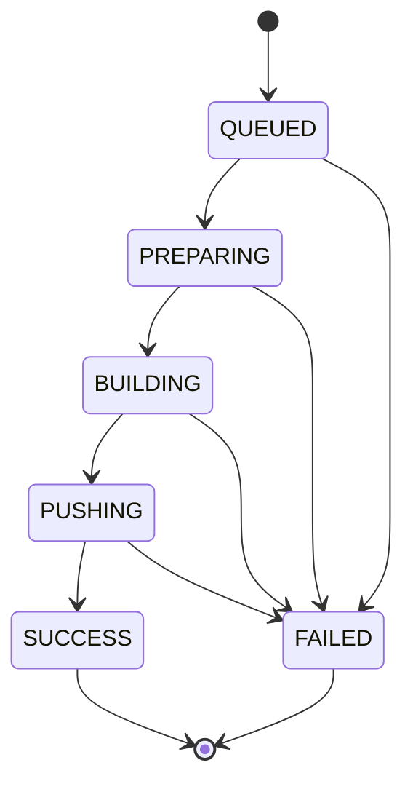
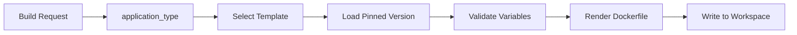
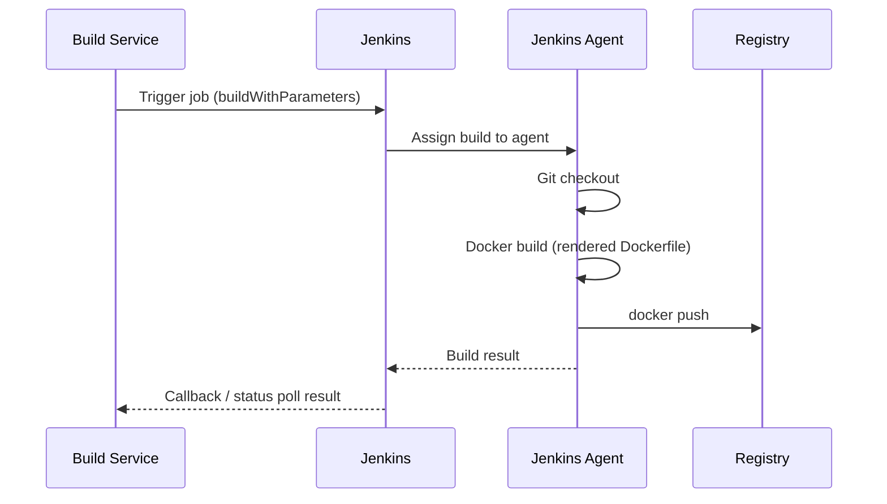
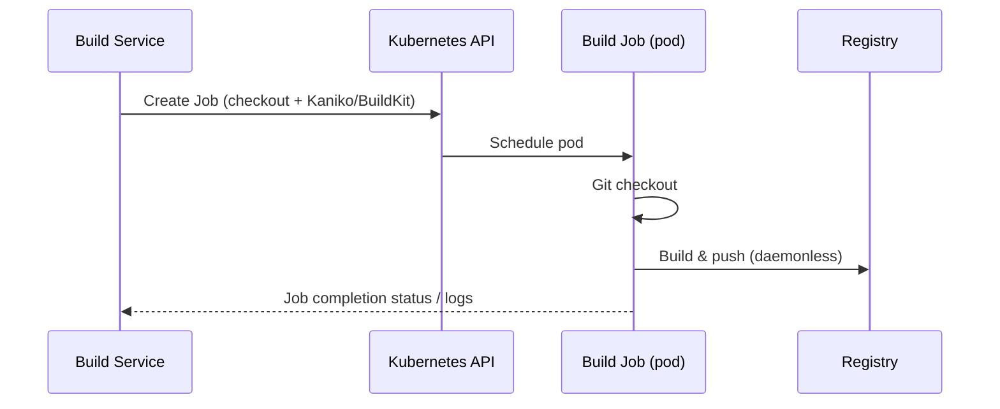
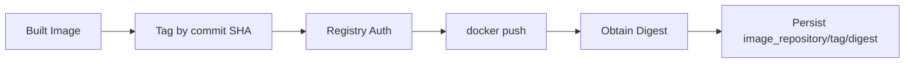
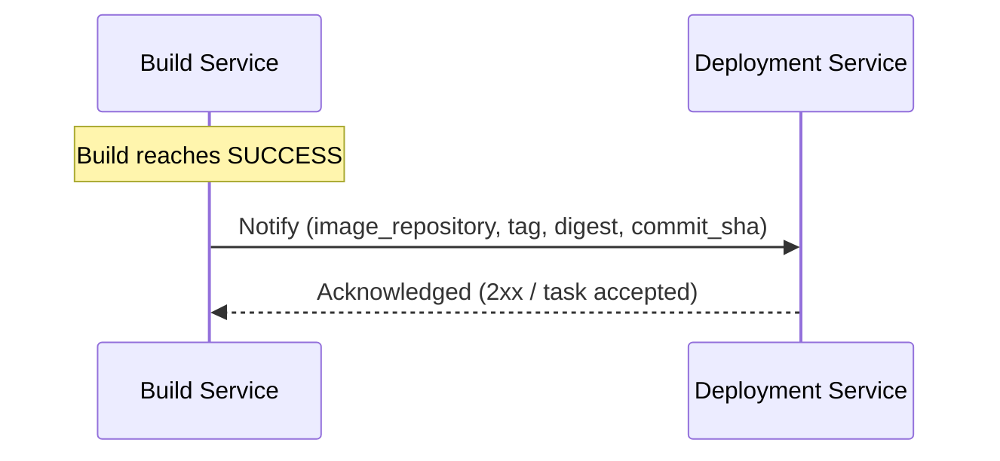
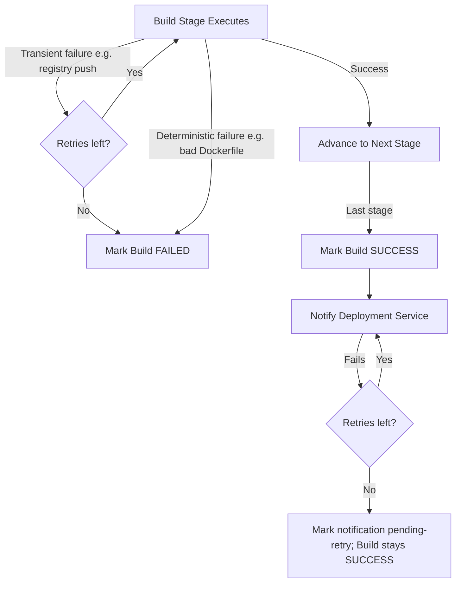

# Build Service

Part of the **Intelligent Infrastructure Automation Platform** — a microservices-based deployment platform.

This README documents **only the Build Service**: how it receives a build request from the Application Service, builds and pushes a container image, tracks the build lifecycle, and notifies the Deployment Service when a usable image exists.

> **Scope boundary:** This document covers the Build Service end-to-end, and the *contracts* on either side of it. It does not design the Application Service's internals (already documented separately) or the Deployment Service's internals (Kubernetes resources, manifests, namespace strategy) — those are explicitly out of scope here.

---

## Table of Contents

1. [System Context](#1-system-context)
2. [Responsibilities](#2-responsibilities)
3. [Input Contract — Application Service](#3-input-contract--application-service)
4. [Transport — Celery/Broker](#4-transport--celerybroker)
5. [Database Schema](#5-database-schema)
6. [Build State Machine](#6-build-state-machine)
7. [Build Template Architecture](#7-build-template-architecture)
8. [Jinja2 Dockerfile Rendering](#8-jinja2-dockerfile-rendering)
9. [Build Execution Strategies](#9-build-execution-strategies)
10. [Strategy Comparison](#10-strategy-comparison)
11. [Build Engine Abstraction](#11-build-engine-abstraction)
12. [Source Code Checkout](#12-source-code-checkout)
13. [Build Workspace](#13-build-workspace)
14. [Dockerfile Generation Flow](#14-dockerfile-generation-flow)
15. [Image Naming](#15-image-naming)
16. [Container Registry](#16-container-registry)
17. [Image Push Flow](#17-image-push-flow)
18. [Build Logs](#18-build-logs)
19. [Build Result Contract](#19-build-result-contract)
20. [Communication with Deployment Service](#20-communication-with-deployment-service)
21. [Communication Method to Deployment Service](#21-communication-method-to-deployment-service)
22. [Deployment Request Contract](#22-deployment-request-contract)
23. [Idempotency](#23-idempotency)
24. [Failure Scenarios](#24-failure-scenarios)
25. [Security](#25-security)
26. [Observability](#26-observability)
27. [Project Structure](#27-project-structure)
28. [Architecture Diagrams](#28-architecture-diagrams)
29. [Architectural Rules](#29-architectural-rules)
30. [Final End-to-End Flow](#30-final-end-to-end-flow)
31. [Decisions Still Open](#31-decisions-still-open)

---

## 1. System Context

| Service | Owns |
|---|---|
| Auth Service | Users, credentials, JWT issuance |
| Application Service | Application metadata, ownership, build initiation |
| **Build Service** (this repo) | Build lifecycle, build execution, image artifacts |
| Deployment Service | Kubernetes resources, running deployments |

Stack: **Python, Django, Django REST Framework, PostgreSQL, Celery, Redis-compatible broker, Docker, a container registry.**

**The Build Service is not the source of truth for application metadata.** It receives a snapshot per build request and stores only what it needs to execute and audit that build — it never queries the Application Service's database, and it never treats its local copy of `name`, `port`, etc. as authoritative for anything other than the build it belongs to.

---

## 2. Responsibilities

**Owns:**
- Accepting and validating build requests
- Creating and tracking `Build` records and their state
- Git checkout / commit resolution
- Selecting and rendering the build template (Dockerfile generation)
- Executing the image build
- Pushing the image to a registry
- Recording image metadata (`repository`, `tag`, `digest`), `commit_sha`
- Reporting build success/failure
- Notifying the Deployment Service once a usable image exists

**Does NOT own:**
- User identity / authentication
- Application CRUD or application metadata as source of truth
- Kubernetes resource creation or deployment logic
- Application runtime management
- Public gateway routing

---

## 3. Input Contract — Application Service

The Application Service sends a full **build request snapshot**, not just an `application_id`:

```json
{
  "request_id": "uuid",
  "application_id": 42,
  "owner_id": 17,
  "name": "mates",
  "repository_url": "https://github.com/omar-mn/mates",
  "branch": "main",
  "application_type": "django",
  "source_directory": "src",
  "requirements_file": "requirements.txt",
  "port": 8000,
  "run_command": "bash ./run.sh"
}
```

**Why a snapshot, not just `application_id`:**

- **No reverse dependency.** If the Build Service only got an ID, it would need to call back into the Application Service (API or DB) before it could even start, creating exactly the kind of tight coupling and availability chain both services are trying to avoid.
- **Reproducibility.** A build should always be reproducible from the request that triggered it. If application config changes mid-build (or the Application Service is temporarily down), the build in flight is unaffected — it builds *what was requested*, not *whatever the row currently says*.
- **Consistency.** The Build Service's own `Build` record becomes a durable, self-contained audit trail of exactly what was asked for, independent of whether the Application Service later changes or even deletes that application.

The Build Service treats this payload as **read-only input**, copies the fields it needs into its own `Build` row, and never writes back to the Application Service's database.

---

## 4. Transport — Celery/Broker

```text
Application Service
        |
        | send_task("builds.start_build", payload)
        v
   Celery Broker (Redis or equivalent)
        |
        | "build" queue
        v
   Build Service Worker
```

| Aspect | Value |
|---|---|
| Queue | `build` |
| Task name | `builds.start_build` |
| Payload | The snapshot in [§3](#3-input-contract--application-service) |
| Acknowledgement | **Early ack, late status update** — see below |

**Early ack vs. ack-after-completion:** the Build Service should acknowledge the Celery message (`ack`) as soon as it has durably persisted a `Build` row in state `QUEUED`, **not** after the (multi-minute) build finishes. Builds can take minutes; holding a message unacknowledged for that long ties up broker/worker resources, risks visibility-timeout-driven redelivery from the broker treating the worker as dead, and conflates "message received" with "build succeeded" — two very different things. Recommended flow: consume message → validate payload → create `Build(status=QUEUED)` → ack → hand off to the actual build execution (a separate internal task/thread/executor call) → update `Build` status as execution progresses. This mirrors the same "commit before acting" principle used on the Application Service side.

**Retries / duplicate delivery:** Celery/Redis brokers are at-least-once — the same message can be redelivered. The Build Service treats `request_id` as an idempotency key (see [§23](#23-idempotency)): a redelivered message for a `request_id` that already has a non-`QUEUED`-only `Build` row is recognized and not re-executed as a second build.

---

## 5. Database Schema

PostgreSQL, owned exclusively by the Build Service.

### `Build`

| Field | Type | Nullable | Indexed | Unique | Immutable after creation | Purpose |
|---|---|---|---|---|---|---|
| `id` | `BigAutoField` (PK) | No | PK | Yes | Yes | Internal identifier |
| `build_id` | `UUIDField` | No | Yes | Yes | Yes | Public identifier for this build, exposed to other services |
| `request_id` | `UUIDField` | No | Yes | Yes | Yes | Idempotency key from the Application Service's request |
| `application_id` | `BigIntegerField` | No | Yes | No | Yes | Reference to Application Service's application — **not a cross-service FK**, a plain ID |
| `owner_id` | `BigIntegerField` | No | Yes | No | Yes | Copied from the request snapshot, for authorization/reporting without a join to another DB |
| `status` | `CharField`, choices enum | No | Yes | No | No (this is the field that transitions) | Current build state, see [§6](#6-build-state-machine) |
| `repository_url` | `URLField` | No | No | No | Yes | Snapshot of the repo to build |
| `branch` | `CharField` | No | No | No | Yes | Snapshot of the branch requested |
| `commit_sha` | `CharField(40)` | Yes → set once resolved | Yes | No | Yes once set | The **exact** commit that was built, resolved at checkout time |
| `application_type` | `CharField`, choices enum | No | Yes | No | Yes | Drives template selection |
| `template_name` | `CharField` | Yes → set once selected | No | No | Yes once set | Which template family was used (`django`, `flask`, ...) |
| `template_version` | `CharField` | Yes → set once selected | No | No | Yes once set | Pinned template version used for this build (see [§7](#7-build-template-architecture)) |
| `image_repository` | `CharField` | Yes | No | No | Yes once set | Registry path of the pushed image |
| `image_tag` | `CharField` | Yes | No | No | Yes once set | Tag of the pushed image |
| `image_digest` | `CharField` | Yes | No | No | Yes once set | Content-addressable digest — the immutable identity of the image |
| `error_code` | `CharField` | Yes | No | No | Yes once set | Machine-readable failure category, see [§24](#24-failure-scenarios) |
| `error_message` | `TextField` | Yes | No | No | Yes once set | Human-readable failure detail |
| `started_at` | `DateTimeField` | Yes | No | No | Yes once set | When execution actually began |
| `finished_at` | `DateTimeField` | Yes | No | No | Yes once set | When execution ended (success or failure) |
| `created_at` | `DateTimeField(auto_now_add=True)` | No | No | No | Yes | Audit |
| `updated_at` | `DateTimeField(auto_now=True)` | No | No | No | No | Audit |

```python
class BuildStatus(models.TextChoices):
    QUEUED = "QUEUED", "Queued"
    PREPARING = "PREPARING", "Preparing"
    BUILDING = "BUILDING", "Building"
    PUSHING = "PUSHING", "Pushing"
    SUCCESS = "SUCCESS", "Success"
    FAILED = "FAILED", "Failed"

class ApplicationType(models.TextChoices):
    DJANGO = "django", "Django"
    FLASK = "flask", "Flask"
    NODE = "node", "Node.js"
    REACT = "react", "React"

class Build(models.Model):
    build_id = models.UUIDField(default=uuid.uuid4, unique=True, editable=False)
    request_id = models.UUIDField(unique=True)
    application_id = models.BigIntegerField(db_index=True)
    owner_id = models.BigIntegerField(db_index=True)
    status = models.CharField(max_length=20, choices=BuildStatus.choices, default=BuildStatus.QUEUED, db_index=True)

    repository_url = models.URLField(max_length=500)
    branch = models.CharField(max_length=200)
    commit_sha = models.CharField(max_length=40, null=True, blank=True, db_index=True)

    application_type = models.CharField(max_length=20, choices=ApplicationType.choices, db_index=True)
    template_name = models.CharField(max_length=50, null=True, blank=True)
    template_version = models.CharField(max_length=20, null=True, blank=True)

    image_repository = models.CharField(max_length=255, null=True, blank=True)
    image_tag = models.CharField(max_length=100, null=True, blank=True)
    image_digest = models.CharField(max_length=100, null=True, blank=True)

    error_code = models.CharField(max_length=50, null=True, blank=True)
    error_message = models.TextField(null=True, blank=True)

    started_at = models.DateTimeField(null=True, blank=True)
    finished_at = models.DateTimeField(null=True, blank=True)

    created_at = models.DateTimeField(auto_now_add=True)
    updated_at = models.DateTimeField(auto_now=True)
```

`application_id` and `owner_id` are plain integer columns with local indexes — **never** `ForeignKey` to another service's table. They exist purely so the Build Service can filter/report ("all builds for application 42") without a cross-database join.

---

## 6. Build State Machine

```text
QUEUED → PREPARING → BUILDING → PUSHING → SUCCESS
   ↓          ↓           ↓          ↓
   └────────────────→ FAILED ←───────┘
```

| State | Meaning | Persisted? |
|---|---|---|
| `QUEUED` | Build message accepted, `Build` row created, not yet picked up for execution | Yes |
| `PREPARING` | Workspace created, repository cloned, commit resolved, template selected/rendered | Yes |
| `BUILDING` | `docker build` (or equivalent) in progress | Yes |
| `PUSHING` | Image push to registry in progress | Yes |
| `SUCCESS` | Image pushed, digest obtained, result persisted | Yes, terminal |
| `FAILED` | Any stage failed | Yes, terminal |

**Internal vs. externally exposed states:** `PREPARING`, `BUILDING`, and `PUSHING` are useful *within* the Build Service (for its own DB row and internal dashboards) but the Application Service and Deployment Service only need a coarser view. Externally, the Build Service exposes just: **queued / in-progress / success / failed** (collapsing `PREPARING`/`BUILDING`/`PUSHING` into "in-progress" for consumers that don't need finer granularity — e.g. an optional lightweight progress callback). This keeps other services decoupled from *how* a build executes internally; if the Build Service later adds a `CACHING` or `SCANNING` sub-stage, no external contract needs to change.

**Persistent vs. transient transitions:** every transition shown above is written to the database — this is a small number of coarse-grained state changes (roughly one per pipeline stage), not a log of every internal executor event (e.g. individual Docker build layers, or Jenkins console-log lines). Those finer-grained, high-frequency execution details are transient and belong in logs (§18), not in state-machine transitions.

---

## 7. Build Template Architecture

```text
templates/
├── django/
│   ├── Dockerfile.j2
│   └── template.yaml
├── flask/
│   ├── Dockerfile.j2
│   └── template.yaml
├── node/
│   ├── Dockerfile.j2
│   └── template.yaml
└── react/
    ├── Dockerfile.j2
    └── template.yaml
```

**Templates live in Git, not PostgreSQL:**

- Templates are **code**: they benefit from code review, diffs, branching, and CI validation the same way application code does. A database row doesn't give you `git blame` or a pull-request review.
- Templates change *slowly and deliberately* compared to build data, which changes constantly — they belong in the same kind of storage as other infrequently-changing, review-gated artifacts (source code), not in an OLTP database built for high-churn transactional rows.
- Storing large text blobs (Dockerfiles) in PostgreSQL for something that's really a version-controlled file is generally an anti-pattern unless there's a strong operational reason (e.g. needing to edit templates at runtime through an admin UI) — no such requirement exists here.

**Versioning:** each template directory carries a `template.yaml` with an explicit version, e.g.:

```yaml
name: django
version: v1
description: Django app served via WSGI, pip-based dependencies
base_image: python:3.12-slim
```

When a build starts, the Build Service resolves the *currently active* version for the requested `application_type` (e.g. `django` → `v2`) and **records that version on the `Build` row** (`template_name`, `template_version`). This means:

- Old builds remain forever reproducible/auditable against the exact template that produced them, even after the template evolves.
- A template can move from `v1` to `v2` (e.g. bumping the base Python image) without retroactively changing what already-built images "were built with" — history stays accurate.
- Rollback is trivial: if `v2` turns out to be broken, new builds can be pointed back at `v1` by config, with zero database migration.

---

## 8. Jinja2 Dockerfile Rendering

**Template** (`templates/django/Dockerfile.j2`):

```dockerfile
FROM {{ python_image }}

WORKDIR /app

COPY {{ requirements_file }} .

RUN pip install --no-cache-dir -r {{ requirements_file }}

COPY {{ source_directory }} .

EXPOSE {{ port }}

CMD {{ run_command }}
```

**Context:**

```python
{
    "python_image": "python:3.12-slim",
    "requirements_file": "requirements.txt",
    "source_directory": "src",
    "port": 8000,
    "run_command": '["bash", "./run.sh"]',
}
```

**Rendered:**

```dockerfile
FROM python:3.12-slim

WORKDIR /app

COPY requirements.txt .

RUN pip install --no-cache-dir -r requirements.txt

COPY src .

EXPOSE 8000

CMD ["bash", "./run.sh"]
```

**Rendering lifecycle:**

```text
Build Request
    ↓
Select template by application_type
    ↓
Load pinned template_version from Git checkout
    ↓
Validate context variables (see below)
    ↓
Jinja2.render(template, context)
    ↓
Write Dockerfile into the temporary build workspace
```

**Validate before rendering, never inject blindly.** Every value that ends up in the rendered Dockerfile must be validated *before* it reaches Jinja2 — templating is not sanitization:

| Variable | Validation before rendering |
|---|---|
| `port` | Integer, in an allowed range (mirrors the Application Service's own validation — re-checked here since the Build Service must not trust an upstream service blindly) |
| `source_directory` | Repo-relative, no `..`, no leading `/`, resolved and checked to stay inside the cloned repo root |
| `requirements_file` | Repo-relative, same traversal checks, and confirmed to actually exist in the checked-out repo before being referenced in `COPY` |
| `application_type` | Must match one of the known enum values with a corresponding template — anything else is rejected before template selection even happens |
| `run_command` | Rendered as a JSON-array-style `CMD` (exec form), never interpolated as a raw shell string into `RUN`/`CMD` in a way that would let embedded shell metacharacters (`;`, `&&`, backticks) break out of the intended command. The exec-form `CMD [...]` array avoids invoking a shell to parse the string at all. |

The underlying principle: **the Dockerfile is generated from constrained, whitelisted template slots, not by string-concatenating arbitrary user input into free-form shell.** Values are inserted as discrete, validated tokens (a path, a port number, a JSON array) into a template *designed* to accept exactly that shape — never as an unconstrained blob that could add new instructions or reshape the file.

---

## 9. Build Execution Strategies

Three concrete implementation approaches are compared before recommending one, because Jenkins is only currently *planned*, not architecturally mandated.

### Option A — Jenkins-based build

```text
Build Service → Trigger Jenkins Job → Jenkins Agent
                                          ↓
                                     Git checkout
                                          ↓
                                    Template rendering*
                                          ↓
                                      Docker build
                                          ↓
                                     Registry push
```
*(rendering can happen in the Build Service before triggering, or on the agent — see §11)*

- **Triggering:** Build Service calls the Jenkins REST API (`POST /job/<name>/buildWithParameters`) with build parameters (repo, branch, commit, rendered Dockerfile or template info).
- **Parameters:** passed as Jenkins job parameters (strings/paths), or by handing the agent a pre-rendered Dockerfile artifact.
- **Status return:** polled via the Jenkins API, or Jenkins is configured with a post-build step that calls back to the Build Service's internal API with the result.
- **Logs:** accessible via Jenkins' own console-log API/URL; the Build Service can store a reference (job name + build number) rather than the raw log text.
- **Secrets:** managed via Jenkins Credentials Binding, not passed through Build Service payloads.
- **Isolation:** depends on Jenkins agent configuration — can be reasonable if each job runs in an ephemeral agent/container, weak if agents are long-lived and shared.
- **Scalability:** limited by the number of provisioned Jenkins agents; scaling requires managing agent pools.
- **Failure handling:** Jenkins exit codes / build result surfaces as success/failure; Build Service maps that to `SUCCESS`/`FAILED`.
- **Complexity / operational overhead:** requires standing up and maintaining a Jenkins controller + agents — non-trivial for a small team, but well-documented and widely known.

### Option B — GitHub Actions-based build

```text
Build Service → GitHub API (workflow_dispatch / repository_dispatch) → GitHub Actions Runner
                                                                             ↓
                                                                          Build
                                                                             ↓
                                                                         Registry
```

- **Authentication:** a GitHub App or PAT with permission to dispatch workflows on the target repo.
- **Private repos:** requires the token/App to also have read access to that specific private repository — meaning every user's repo needs to grant access, which is more involved than a build system cloning with its own credentials.
- **Triggering:** `workflow_dispatch` (manual-style API trigger) or `repository_dispatch` (custom event), passing build inputs as workflow inputs.
- **Result handling:** no synchronous return value from dispatch; the workflow itself must call back to the Build Service's internal API (or write to a status check) when it finishes.
- **Limitations / coupling:** tightly couples the build pipeline to GitHub specifically — doesn't work for GitLab/Bitbucket-hosted repos without separate integrations; also depends on the *user's own repository* containing (or being augmented with) a workflow file, which is an unusual amount of platform-imposed structure on user repos for this project's use case.
- **Advantages:** zero infrastructure to run (GitHub-hosted runners); natural fit if the platform's target audience already lives entirely on GitHub.
- **Disadvantages:** hard GitHub-only coupling; less control over the exact build environment; harder to support the "any Git host" ambition implied by a generic `repository_url` field.

### Option C — Kubernetes-native build (BuildKit / Kaniko)

```text
Build Service → Kubernetes Job → Git checkout (init container) → BuildKit/Kaniko → Registry
```

- **Why this avoids Docker-in-Docker:** Kaniko and BuildKit's rootless mode build images *without* a Docker daemon socket, so a build Job doesn't need privileged access to the host's Docker daemon (the classic DinD security and reliability problem) — each build runs as an isolated, disposable pod.
- **Isolation:** strong — each build is its own Kubernetes Job/pod, naturally sandboxed by the cluster's usual pod isolation (namespaces, resource limits, network policy).
- **Kubernetes integration:** very natural if the platform already runs on Kubernetes for the Deployment Service — one cluster, one set of RBAC/network policies to reason about.
- **Resource limits:** directly expressible as standard Kubernetes `resources.requests`/`limits` on the build Job/pod.
- **Security:** no daemon socket to protect; each build's blast radius is a single pod.
- **Complexity:** requires the team to already be comfortable operating Kubernetes and to build (no pun intended) the Job-spawning logic and log/result retrieval path themselves — there's no polished off-the-shelf UI/API layer the way Jenkins provides one.
- **Caching:** BuildKit supports layer caching via a registry-based cache or a persistent volume; Kaniko supports a cache flag pointing at a registry — both need explicit setup, unlike Docker's local daemon cache.
- **Scalability:** scales exactly as well as the underlying Kubernetes cluster's node capacity — a natural fit for bursty build load.

(No Kubernetes manifests are defined here — that belongs to the eventual implementation of this option, and any Kubernetes *deployment* manifests at all belong to the Deployment Service, not this document.)

---

## 10. Strategy Comparison

| Factor | Jenkins | GitHub Actions | Kubernetes-native (BuildKit/Kaniko) |
|---|---|---|---|
| Self-hosted | Yes | No (GitHub-hosted) / partial (self-hosted runners) | Yes |
| GitHub dependency | No | Yes, hard dependency | No |
| Kubernetes integration | Indirect (agents can run on K8s, but not required) | None | Native |
| Build isolation | Depends on agent setup | Good (ephemeral runners) | Strong (per-pod) |
| Scaling | Manual agent pool management | Elastic (GitHub-managed) | Elastic (cluster capacity) |
| Setup complexity | Moderate–high (controller + agents) | Low (if using GitHub-hosted runners) | High (custom Job orchestration) |
| Operational overhead | Ongoing (upgrades, agent maintenance) | Low (offloaded to GitHub) | Moderate–high (own the orchestration) |
| Private repositories | Straightforward (own credentials) | Requires per-repo GitHub App/token grants | Straightforward (own credentials) |
| Registry integration | Plugin ecosystem, flexible | Marketplace actions, flexible | Native `docker push`/Kaniko flag, flexible |
| Logs | Built-in console log UI/API | Built-in Actions log UI/API | Must be captured from pod logs and stored |
| Security considerations | Agent/daemon hardening; credential binding | Trusting GitHub's runner environment; secret scoping | No daemon socket; strong pod isolation, but you own the RBAC |
| Suitability for this project | **Good fit for v1** — team already plans to use it, mature tooling, doesn't require the repo to be on GitHub | Poor fit if the platform wants to support arbitrary Git hosts | **Strong long-term fit** if/when the platform is fully Kubernetes-native, but more upfront work than a graduation project timeline typically allows |

**Recommendation (not a mandate):** for the initial version of this graduation project, **Jenkins** is the pragmatic choice — it's already the planned direction, it doesn't force every user's repository to live on GitHub (unlike Option B, which would undermine the generic `repository_url` design decided in the Application Service), and it doesn't require the team to have already built out Kubernetes Job orchestration (Option C) before a single build can run. The Kubernetes-native approach is the most architecturally "clean" long-term direction *if* the whole platform ends up Kubernetes-centric, and is worth revisiting post-graduation. This recommendation is explicitly conditional on the abstraction in [§11](#11-build-engine-abstraction) being respected, so switching later is a swap, not a rewrite.

---

## 11. Build Engine Abstraction

```text
Build Service (domain logic)
        ↓
  BuildExecutor (interface)
        ├── JenkinsExecutor
        ├── GithubActionsExecutor
        └── KubernetesBuildExecutor
```

```python
class BuildExecutor(Protocol):
    def start(self, build: Build, rendered_dockerfile_path: str) -> ExecutionHandle: ...
    def get_status(self, handle: ExecutionHandle) -> ExecutionStatus: ...
    def get_logs_reference(self, handle: ExecutionHandle) -> str: ...
```

**Why not couple domain logic directly to Jenkins:** the decision in [§10](#10-strategy-comparison) is explicitly a *recommendation for v1*, not a permanent architectural commitment — the comparison itself exists because the team may reasonably revisit it. If `services.py`/`tasks.py` called the Jenkins API directly, switching engines later would mean touching every call site that cares about "how a build runs" instead of writing one new class. The interface is intentionally small (start / check status / get a log reference) — just enough to keep the domain layer (state machine, DB writes, result contract) engine-agnostic, without building a large plugin framework nobody asked for.

---

## 12. Source Code Checkout

Required from the request: `repository_url`, `branch`. Optionally a specific `commit_sha` (e.g. for a rebuild-exact-commit feature later).

**Branch head vs. resolved commit vs. stored SHA — three distinct things:**
- *Building the branch head* means checking out whatever the branch currently points to — convenient, but not reproducible, since the branch can move between request and execution.
- *Resolving a commit SHA* means, at checkout time, asking Git "what does `branch` currently point to?" and capturing that exact SHA.
- *Storing the resolved SHA* means persisting that value on the `Build` row so that, forever after, anyone can answer "what code did this build actually contain?" — even if the branch has since moved far ahead.

**The final build record always stores the resolved SHA**, never just the branch name, because "main" is a moving target and isn't sufficient for reproducibility or for tagging the image (§15).

**Public vs. private repositories:** v1 targets **public repositories only** (mirroring the Application Service's current scope). Private-repo support is a clearly deferred, separate piece of work involving:
- **HTTPS tokens** (e.g. a GitHub/GitLab personal access token or App installation token) — simpler to scope per-repository, easier to rotate.
- **SSH keys** — better suited to a model where the platform holds one long-lived deploy key per repo, but key management/rotation is more operationally involved than token-based auth.

Whichever is chosen later, **credentials are never stored in the Build database** (plaintext or otherwise) — they belong in a secrets manager or the platform's dedicated credential store, referenced by an opaque identifier if the Build record needs to note that a credential was used at all.

---

## 13. Build Workspace

```text
Build Worker
    ↓
/tmp/builds/<build_id>/          (temporary workspace)
    ├── repo/                    (cloned repository)
    ├── Dockerfile                (rendered)
    └── metadata.json             (local scratch metadata, not the DB)
```

- **Temporary by design:** a workspace exists only for the lifetime of one build and is deleted once the build reaches `SUCCESS` or `FAILED` — it's disposable execution scratch space, not a persistent artifact store.
- **Cleanup:** deleted on both success and failure paths (`finally`-style guarantee in the executor), plus a periodic sweep job that removes any workspace older than a safety threshold (covers worker crashes that skip normal cleanup).
- **Isolation between builds:** each workspace is keyed by `build_id`, so concurrent builds never share a directory; nothing from one build's clone or rendered Dockerfile is visible to another.
- **Disk usage:** bounded by the cleanup policy above plus per-workspace size limits (e.g. reject a repo checkout beyond a configured size) to prevent one build from exhausting worker disk.
- **Failed builds:** the workspace is still cleaned up (after optionally persisting relevant logs elsewhere, §18) — a failed build's leftover files are debugging convenience at best and a disk-usage/security liability if left indefinitely.
- **Cross-build contamination:** avoided structurally by the per-`build_id` directory naming — there is no shared mutable state (e.g. a single reused clone directory) between builds, even for the same application repository.

---

## 14. Dockerfile Generation Flow

```text
Build Request
    ↓
application_type
    ↓
Select template (templates/<type>/)
    ↓
Load pinned template_version
    ↓
Validate template variables (§8)
    ↓
Render Dockerfile (Jinja2)
    ↓
Write into temporary Build Workspace (§13)
```

**The rendered Dockerfile is a build artifact, not a permanent database object.** It's regenerable at any time from `template_name` + `template_version` + the original request snapshot's relevant fields — so persisting the full text in PostgreSQL would be redundant storage of derived data. What *is* persisted on the `Build` row:

```text
template_name
template_version
```

and, optionally, a `rendered_dockerfile_hash` (e.g. SHA-256 of the rendered content) — cheap to store, and useful for detecting "did this build's actual Dockerfile differ from what the template+version alone would produce today" without keeping the full text around.

---

## 15. Image Naming

Recommended pattern:

```text
<registry>/<platform>/<owner_id>/<application_name>:<git-sha>
```

Example: `registry.example.com/autodeployers/17/mates:a82f91c`

**Trade-offs:**
- Including `owner_id` in the path avoids name collisions between different users' applications that happen to share a name (recall: `Application.name` is only unique *per owner* on the Application Service side, not globally).
- Using `<application_name>` rather than `<application_id>` in the tag path makes the registry human-browsable; either is defensible, but the ID avoids issues if a user renames their app later (the image path wouldn't need to change to stay "accurate"). This is a minor judgment call the team can adjust.
- **Never rely exclusively on `latest`** as the tag — `latest` is mutable and non-reproducible; two different builds could each claim to be "latest" for the same app with no way to tell which is actually running. Tagging by resolved **commit SHA** ties every image unambiguously to the exact source it was built from.

The final build result always retains all three of:

```text
image_repository
image_tag
image_digest
```

**Why the digest matters even though there's already a tag:** a tag is a mutable pointer (in most registries, nothing stops a tag from being overwritten to point at different bytes later), while a **digest** (`sha256:...`) is a content hash — the actual immutable identity of the image. The Deployment Service should ultimately pull by digest (or at minimum verify the digest) to guarantee it's running exactly the artifact this build produced, not "whatever `a82f91c` happens to point to right now."

---

## 16. Container Registry

| Registry | Notes |
|---|---|
| **Docker Hub** | Simplest to start with; external hosted service; private repos available depending on plan; rate limits on the free tier can matter for a CI-heavy workflow |
| **Amazon ECR** | Private by default; integrates with IAM for access control; natural choice if the rest of the infrastructure is already on AWS; adds an AWS dependency |
| **Harbor** | Self-hosted, vendor-neutral, full control over retention/scanning policies; highest operational overhead (you run and maintain it yourself) |

**Registry operations are abstracted behind an interface**, mirroring the build-executor abstraction:

```text
ContainerRegistry (interface)
    ├── DockerHubRegistry
    ├── ECRRegistry
    └── HarborRegistry
```

```python
class ContainerRegistry(Protocol):
    def push(self, local_image_ref: str, repository: str, tag: str) -> PushResult: ...
    def get_digest(self, repository: str, tag: str) -> str: ...
```

Only the interface and a chosen default implementation need to exist for v1 (see [Decisions Still Open](#31-decisions-still-open)); the point is that swapping Docker Hub for ECR later is a new adapter class, not a rewrite of the push flow.

---

## 17. Image Push Flow

```text
Dockerfile
    ↓
docker build (or BuildKit/Kaniko equivalent)
    ↓
tag image (registry/path:sha)
    ↓
registry authentication
    ↓
docker push
    ↓
obtain digest (from push response / registry API)
    ↓
persist build result (image_repository, image_tag, image_digest)
```

**Registry credentials:** obtained from a secrets manager / environment-injected credential (never hardcoded, never stored in the `Build` table). Registry passwords/tokens are configuration for the *worker process/executor*, scoped as narrowly as the registry allows (e.g. a push-only ECR IAM role, a Docker Hub access token limited to specific repositories) — never persisted alongside build metadata.

---

## 18. Build Logs

| Approach | Trade-offs |
|---|---|
| **Store complete logs in PostgreSQL** | Simple to query, but logs can be large/unbounded text blobs in an OLTP database not designed for that access pattern; bloats backups and slows unrelated queries over time |
| **Store logs in object storage** (e.g. S3-compatible bucket), keep a reference in `Build` | Scales well for large/many logs, cheap, and keeps the relational DB lean; requires standing up/configuring object storage |
| **Store logs in the build engine, keep only a reference** (e.g. Jenkins job/build number) | Zero extra storage to manage; but couples log availability to the build engine's own retention policy, and makes cross-engine consistency harder if the engine is swapped later (§11) |
| **Stream logs live to the platform** | Best UX (real-time feedback), but the most implementation effort (websocket/streaming infrastructure) — more than a graduation-project v1 needs |

**Recommendation for v1:** store a **reference**, not the full text, on the `Build` row (e.g. `log_reference` pointing at the Jenkins job/build number, or an object-storage key if logs are exported there) and fetch/display logs on demand through a dedicated endpoint that proxies to wherever they actually live. This keeps `Build` rows small and fast to query, defers picking a specific log backend, and still lets the frontend display logs when the user asks — it just fetches them lazily rather than always carrying them inline. **The Build Service owns this reference** even though the bytes may physically live elsewhere.

---

## 19. Build Result Contract

**Success:**

```json
{
  "build_id": "uuid",
  "application_id": 42,
  "status": "success",
  "image_repository": "registry.example.com/autodeployers/mates",
  "image_tag": "a82f91c",
  "image_digest": "sha256:....",
  "commit_sha": "a82f91c",
  "template_name": "django",
  "template_version": "v1",
  "started_at": "2026-09-24T12:00:00Z",
  "finished_at": "2026-09-24T12:04:31Z"
}
```

**Failure:**

```json
{
  "build_id": "uuid",
  "application_id": 42,
  "status": "failed",
  "image_repository": null,
  "image_tag": null,
  "image_digest": null,
  "commit_sha": "a82f91c",
  "error_code": "DOCKER_BUILD_FAILED",
  "error_message": "Docker build failed",
  "started_at": "2026-09-24T12:00:00Z",
  "finished_at": "2026-09-24T12:02:10Z"
}
```

This is the canonical shape reported back to the Application Service (per the contract already defined there) and is the same source data used to build the (slightly different, purpose-built) payload sent to the Deployment Service in §22.

---

## 20. Communication with Deployment Service

**Boundary only** — Deployment Service internals (Kubernetes Deployments, Services, Gateway/HTTPRoute config, namespace strategy, pod configuration, replica logic) are explicitly **not** defined here.

```text
Build Service
    |
    | build succeeded
    v
Deployment Service
```

The Build Service notifies the Deployment Service **only after a build reaches `SUCCESS`** — a failed build is never forwarded downstream, since there is no image to deploy.

Payload includes everything needed to identify the exact image:

```json
{
  "build_id": "uuid",
  "application_id": 42,
  "owner_id": 17,
  "image_repository": "registry.example.com/autodeployers/mates",
  "image_tag": "a82f91c",
  "image_digest": "sha256:....",
  "commit_sha": "a82f91c",
  "application_type": "django",
  "port": 8000
}
```

**Why `image_repository` / `image_tag` / `image_digest` are all included:** the repository and tag alone are enough to *pull* the image, but the **digest is what pins the Deployment Service to the exact bytes** this specific build produced — protecting it from a tag being mutated or reused after the fact. Sending all three lets the Deployment Service pull by tag for convenience while verifying (or directly referencing) the digest for correctness.

The Deployment Service does **not** need, and is not sent: template details, build duration, log references, or anything about *how* the image was produced — it only needs an immutable reference to *what* was produced.

---

## 21. Communication Method to Deployment Service

| | Option A: HTTP callback | Option B: Celery message/event | Option C: Event bus (future) |
|---|---|---|---|
| Simplicity | High — one endpoint, one payload | Moderate — another queue/task to define | Lower — new infrastructure component |
| Reliability | Depends on Build Service implementing its own retry-on-failure | Broker-backed at-least-once delivery, retries "for free" | Strong, but overkill for current scale |
| Coupling | Direct (Build Service must know Deployment Service's URL) | Looser (Build Service only knows a queue/task name) | Loosest (publish-and-forget to a topic) |
| Retry behavior | Manual (Build Service must implement backoff/retry) | Native to Celery (task retry policy) | Native to the bus |
| Observability | Simple request/response logging | Requires broker/queue monitoring | Requires bus monitoring |
| Idempotency | Must be engineered explicitly (idempotency key + dedup) | Same requirement, same solution (idempotency key), just different transport | Same requirement |

**Recommendation for v1:** mirror the pattern already used between Application Service and Build Service — **a Celery message** (Option B) is slightly favored for consistency (one transport pattern across the whole platform, one broker to operate) and built-in retry semantics, but **a direct HTTP callback (Option A) is an equally reasonable, arguably simpler choice** for a first version, and is explicitly left as a decision for the team (see [§31](#31-decisions-still-open)) rather than locked in here. An event bus (Option C) is noted only as a plausible future evolution once there are more than two downstream consumers of "a build succeeded" — not justified at the current scale.

---

## 22. Deployment Request Contract

Whichever transport is chosen, the contract shape stays the same:

- **Transport:** HTTP (`POST /internal/deployments/`) or Celery task (`deployments.deploy_image`) — see [§21](#21-communication-method-to-deployment-service).
- **Authentication:** internal service-to-service credential (shared secret / service token), never a user JWT, mirroring the same pattern used for the Application Service's build-result callback.
- **Payload:**

```json
{
  "request_id": "uuid",
  "build_id": "uuid",
  "application_id": 42,
  "image_repository": "...",
  "image_tag": "...",
  "image_digest": "...",
  "commit_sha": "..."
}
```

- **Expected acknowledgement:** if HTTP, a `2xx` response means "Deployment Service has durably recorded the request," not "the deployment is live" — deploying is itself asynchronous and out of scope here. If Celery, successful task acceptance plays the same role.
- **Retry behavior:** the Build Service retries a failed notification a bounded number of times with backoff; after exhausting retries it marks the notification itself (not the build) as failed/pending-retry, since the build already succeeded regardless of whether the downstream notification did.
- **Idempotency key:** `request_id` (generated fresh per notification attempt) alongside the stable `build_id` — the Deployment Service is expected to treat `build_id` as the true de-duplication key, since retries of the *same* notification should never create two deployments for one build.
- **Failure handling:** notification failures do not roll back or invalidate the underlying successful build — the image already exists in the registry regardless of whether Deployment Service has been told about it yet.

**The Deployment Service does not need to understand how the image was built** — no template info, no commit history, no build duration. It receives a reference to an already-immutable artifact and treats the Build Service's internal process as a black box.

---

## 23. Idempotency

| Scenario | Handling |
|---|---|
| Build task delivered twice (Celery redelivery) | `request_id` uniqueness on `Build` — a second message for the same `request_id` finds the existing row and is a no-op re-execution guard rather than starting a duplicate build |
| Jenkins (or other executor) callback delivered twice | The executor callback handler is written to be idempotent: updating a `Build` that's already `SUCCESS`/`FAILED` with the same terminal result is a safe no-op, not a second state transition |
| Registry push retried after a transient network error | Pushing the same tag/digest again is naturally idempotent at the registry level (the layers already exist); the Build Service only needs to avoid double-counting/double-notifying downstream |
| Deployment notification sent twice | `build_id` as the de-duplication key on the Deployment Service side (§22) — the Build Service's responsibility is simply to always send the same `build_id` for the same build, never to generate a new one on retry |

The general pattern throughout: **the requester (upstream) generates a fresh per-attempt `request_id` to make its own retries traceable, while a stable per-entity ID (`build_id`) is what the receiver actually de-duplicates against.**

---

## 24. Failure Scenarios

| Failure | Build status | Retry appropriate? | Downstream notified? |
|---|---|---|---|
| Invalid repository URL (malformed) | `FAILED` (fails validation before execution starts) | No — this is a request-shape error | No |
| Repository not found | `FAILED` | No (unless transient DNS/network — see below) | No |
| Git authentication failure | `FAILED` | No — retrying won't fix bad/missing credentials | No |
| Branch not found | `FAILED` | No | No |
| Template missing for `application_type` | `FAILED` | No — this is a platform config error, needs a human fix | No |
| Template rendering failure (invalid/missing variable) | `FAILED` | No — same input will fail again | No |
| Docker build failure (e.g. bad dependency, failing `RUN` step) | `FAILED` | No — the source code itself is the problem | No |
| Registry authentication failure | `FAILED`, but flagged distinctly (e.g. `error_code=REGISTRY_AUTH_FAILED`) | Possibly, if credentials were just rotated/misconfigured and a human fixes it — not an automatic retry | No |
| Registry push failure (transient network) | Retry the push step a small bounded number of times before marking `FAILED` | Yes, limited automatic retries | No (until success) |
| Jenkins/executor infrastructure failure (agent crash, controller unreachable) | `FAILED`, distinct `error_code` (e.g. `EXECUTOR_UNAVAILABLE`) | Possibly — could be resubmitted as a new build attempt, but not silently auto-retried without limit | No |
| Celery broker failure (message never delivered) | No `Build` row may exist yet — this is an Application Service-side concern (their publish fails, they surface `503` to the user) | N/A from Build Service's perspective | N/A |
| Worker crash mid-build | Build is left in a non-terminal state (`PREPARING`/`BUILDING`/`PUSHING`); a periodic reconciliation job detects builds stuck past a timeout and marks them `FAILED` with `error_code=WORKER_CRASHED` | The build can be resubmitted as a fresh request | No |
| Callback/notification to Deployment Service fails | Build itself stays `SUCCESS` — only the *notification* is retried (§22) | Yes, bounded retries on the notification | Eventually, once retry succeeds |
| Deployment Service unavailable | Same as above — treated as a notification-delivery problem, not a build failure | Yes, bounded retries with backoff | Eventually |

General principle: a failure **before or during image creation** is a build failure (`FAILED`, terminal, not retried automatically for deterministic causes like bad source/config). A failure **after a successful build**, in getting the news to the Deployment Service, is a *delivery* problem and must never be allowed to flip an already-successful build back to failed.

---

## 25. Security

- **Input validation:** every field from the Application Service's snapshot is re-validated on entry (never trusted blindly, even though it came from another trusted-ish internal service) — port ranges, path traversal, enum membership, string length limits.
- **Repository credentials:** never stored in the Build database; sourced from a secrets manager, scoped as narrowly as possible (read-only, single-repo where supported).
- **Registry credentials:** same principle — push-scoped, never embedded in `Build` rows or logs.
- **Build isolation:** each build gets its own disposable workspace (§13) and, ideally, its own disposable execution environment (container/pod/agent) — no shared mutable state between concurrent builds.
- **Untrusted source code:** the single most important security fact about this service — **it clones and builds arbitrary user-supplied repositories.** The build step must be treated as executing untrusted code, sandboxed accordingly (least-privilege execution user, network egress restrictions where feasible, resource limits to prevent fork-bombs/resource exhaustion from a malicious build step).
- **Command injection:** addressed at the template layer (§8) — validated, typed slots rendered into a constrained template, never raw string concatenation of user input into a shell invocation.
- **Docker daemon security:** if using a Docker-daemon-based build path (Option A/Jenkins with classic Docker), the daemon socket is a high-value target — access must be tightly restricted to the build process only, never exposed to the wider network.
- **Docker-in-Docker risks:** running Docker builds inside containers via a mounted daemon socket effectively grants host-level privileges to whatever runs inside — this is exactly the risk Option C (Kaniko/BuildKit) is designed to avoid; if Jenkins agents run in containers, prefer rootless/daemonless build tooling inside them where possible even under Option A.
- **Container privilege concerns:** build containers/pods should run with the minimum privilege needed (avoid `--privileged`, drop unnecessary Linux capabilities).
- **Secrets exposure:** secrets must never be baked into image layers, printed to build logs, or written into the workspace metadata that gets cleaned up (rather than securely wiped) — a "temporary" file is still a leak if it briefly touches disk in cleartext.
- **Temporary workspace cleanup:** guaranteed on both success and failure paths (§13), including a sweep for orphaned workspaces from crashed workers.
- **Internal service authentication:** every service-to-service call (from Application Service, to Deployment Service) uses an internal credential distinct from user-facing JWTs.
- **HTTPS:** required in production for every internal HTTP endpoint (build-result callback receipt, deployment notification).

---

## 26. Observability

At minimum, the Build Service should expose/record:

- Build duration (per build, and aggregate percentiles)
- Build count (total, per application, per time window)
- Success/failure count and ratio
- Current build state distribution (how many builds are `QUEUED`/`BUILDING`/etc. right now)
- Worker status/health (are workers alive and consuming the queue)
- Queue depth (how backed up the `build` queue is)
- Registry push duration (isolated from total build duration, since it's a distinct failure/latency domain)
- Build logs (accessible per §18, even if not stored inline)
- Error categories/counts by `error_code` (to spot systemic issues vs. one-off user errors)

This should be exposed at a level a monitoring/alerting system can consume (metrics + structured logs), without this document prescribing a specific tool.

---

## 27. Project Structure

```text
build_service/
├── manage.py
├── config/                     # settings, root urls.py, celery.py
├── builds/
│   ├── models.py                # Build
│   ├── serializers.py
│   ├── tasks.py                 # builds.start_build consumer
│   ├── services.py              # orchestration: create Build, run pipeline stages
│   ├── selectors.py             # queries (builds by application, by status, etc.)
│   ├── urls.py
│   └── views.py                 # internal result-callback endpoints from executors
├── templates/
│   ├── django/
│   ├── flask/
│   ├── node/
│   └── react/
├── integrations/
│   ├── jenkins/                 # JenkinsExecutor (implements BuildExecutor)
│   ├── registries/              # DockerHubRegistry / ECRRegistry / HarborRegistry
│   └── git/                     # checkout + commit resolution helpers
└── celery.py
```

Kept intentionally flat — `integrations/` holds the swappable adapters (§11, §16), `builds/` holds the domain logic and DB, `templates/` holds the version-controlled Dockerfile templates (§7). No additional layering is introduced purely for structure's sake.

---

## 28. Architecture Diagrams

### High-level Build Service



### Build lifecycle



### Template rendering flow



### Jenkins implementation flow



### Kubernetes-native implementation flow



### Registry flow



### Build Service → Deployment Service flow



### Failure/retry flow



---

## 29. Architectural Rules

1. Build Service owns detailed build records.
2. Application Service owns application metadata.
3. Build Service receives a build snapshot, not just an ID.
4. Build Service must not depend on direct access to the Application Service's database.
5. Build Service does not own Kubernetes deployment.
6. Build Service produces an immutable container artifact.
7. Every successful build must record the exact commit SHA.
8. Every successful build must record image repository, tag, and digest.
9. Generated Dockerfiles are temporary build artifacts unless there is a deliberate reason to persist them.
10. Dockerfile templates are version-controlled (Git), not stored in PostgreSQL.
11. The template version used by each build must be recorded on that build.
12. Build execution should be isolated from the Django API process.
13. Long-running build operations must be asynchronous.
14. The build engine should be replaceable behind an abstraction (`BuildExecutor`).
15. Registry access should be abstracted behind a registry interface (`ContainerRegistry`).
16. Deployment Service receives an immutable image reference and does not need to know how it was produced.

---

## 30. Final End-to-End Flow

```text
User
 ↓
Application Service
 ↓
Celery
 ↓
Build Service
 ↓
Create Build
 ↓
Resolve Git Commit
 ↓
Select Template
 ↓
Render Dockerfile
 ↓
Build Image
 ↓
Push Image
 ↓
Obtain Image Digest
 ↓
Persist Build Result
 ↓
Notify Deployment Service
 ↓
Deployment Service
```

This document stops at the Deployment Service boundary. What Deployment Service does with the image reference after receiving it is outside this service's scope.

---

## 31. Decisions Still Open

These are explicitly **not** decided by this document and should be finalized by the team before/during implementation:

- **Jenkins vs. GitHub Actions vs. Kubernetes-native build** — a recommendation (Jenkins for v1) is given in [§10](#10-strategy-comparison), but this is a starting point, not a locked-in decision.
- **Redis vs. RabbitMQ** as the Celery broker.
- **HTTP callback vs. Celery message** for Build Service → Deployment Service communication ([§21](#21-communication-method-to-deployment-service) leans slightly toward Celery for consistency, but flags HTTP as equally reasonable).
- **Docker Hub vs. Amazon ECR vs. Harbor** as the container registry.
- **Log storage strategy** — object storage vs. engine-native references vs. live streaming ([§18](#18-build-logs) recommends a reference-based approach for v1, but the specific backend is unchosen).
- **Private repository authentication strategy** — HTTPS tokens vs. SSH keys, and how/where credentials are stored per user/repo.
- **Build concurrency policy** — whether the Build Service itself should cap concurrent builds per application/owner/cluster-wide (note: the Application Service already rejects a second build request while one is active for the same application at the API level — this item is about whether the Build Service needs its *own* independent concurrency control, e.g. for worker pool sizing).
